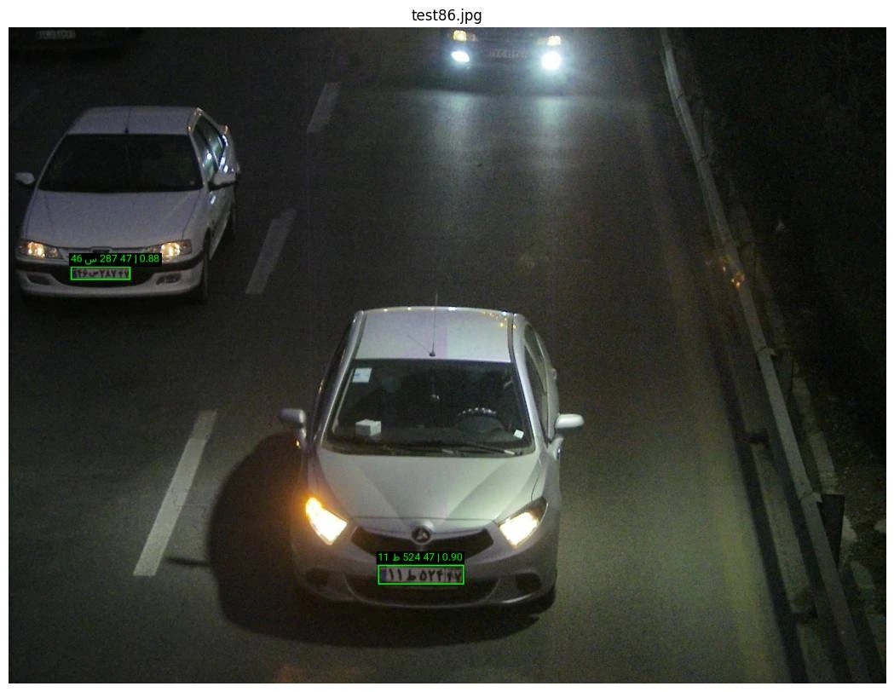

<div align="center">



<br />

<a href="https://samafshar2011.github.io"></a>
<a href="https://github.com/SamAfshar2011?tab=repositories"></a>
<a href="https://github.com/SamAfshar2011?tab=followers"></a>


</div>

<br />

<div align="center">
  
</div>

<br />

> [!NOTE]
> **The part I like starts after the model works.**
> I started programming in 2024 with Python. The interesting question quickly stopped being *“can I train a model?”* and became:
> **can I turn the idea into a complete system** — one that handles data, uncertainty, validation, failure states, interfaces and real constraints?
> No inflated titles, no fake skill bars. Just the work, including the parts that didn’t come out perfect.

<br />

<h2 align="center">◆ Selected systems ◆</h2>

<p align="center"><sub>Three projects. Three domains. One habit: the model is only one part of the work.</sub></p>

<br />

<a href="https://github.com/SamAfshar2011/innoverse2026-Fiscora">
  
</a>

**Fiscora** separates two kinds of intelligence on purpose: explicit, inspectable algorithms where auditability matters, and learned models only where prediction *is* the experiment.

<details>
<summary><b>Engineering details →</b></summary>
<br />

- Deterministic **month-end projection** from recent spending and weekday behaviour, with **bootstrap-based uncertainty**
- Explicit **financial-health score**, anomaly checks, recurring-payment detection, savings scenarios and a **What-If simulator**
- **Receipt OCR** with a human review step before anything is committed
- Multi-task **LSTM** over a six-month sequence of scale-independent features → next-month spending growth + overspend probability
- Experimental **Conv1D/LSTM Bitcoin model**, evaluated against naive baselines instead of being sold as a trading oracle
- **FastAPI** backend, local JSON persistence, bilingual Iran/US behaviour, and an AI assistant that retrieves *computed* facts rather than inventing context

**Honest limits:** the behaviour model was trained on a synthetic-but-coherent panel, not a production population — and the Bitcoin experiment does **not** show a material edge over naive baselines. Keeping that visible is part of the project.

`Python` `FastAPI` `TensorFlow/Keras` `LSTM` `Conv1D` `EasyOCR` `pandas` `NumPy` `HTML/CSS/JS`

</details>

<p align="right"><a href="https://github.com/SamAfshar2011/innoverse2026-Fiscora"><b>View source ↗</b></a></p>

<br />

<a href="https://github.com/SamAfshar2011/1i1w_competition">
  
</a>

**ANKA** is an earthquake-safety system built as **preliminary decision support and education** — never as a replacement for a structural engineer.

<details>
<summary><b>Engineering details →</b></summary>
<br />

- Eight building and seismic inputs → **engineered features** → schema alignment and scaling → a **TensorFlow dense network** that estimates collapse risk
- Four risk bands, from low to critical, turned into understandable context instead of a bare number
- Rule-based safety guidance in **English, Persian and Turkish**
- A browser-based **2D earthquake simulator** with its own time-stepped physics loop and visual damage state
- A contextual AI assistant that receives the building state
- Generated **PDF reports** plus a report-registry / verification workflow

**The boundary is part of the engineering:** ANKA is not a certified structural inspection, engineering report or governmental safety evaluation — and it says so.

`Python` `TensorFlow/Keras` `feature engineering` `HTML/CSS/JS` `multilingual UI` `PDF reports` `LLM-assisted guidance`

</details>

<p align="right"><a href="https://github.com/SamAfshar2011/1i1w_competition"><b>View source ↗</b></a></p>

<br />

<a href="https://github.com/SamAfshar2011/Persian_ALPR_project">
  
</a>

**PlateHunter** reads Iranian license plates through explicit, inspectable stages — and refuses to accept a result just because every model returned *something*.

```text
frame → YOLO plate detector → crop → YOLO character detector → 8 sorted crops
      → ConvNeXt classifier → format + confidence validation → Kalman / Hungarian tracking
```

<details>
<summary><b>Engineering details →</b></summary>
<br />

- Valid Iranian plates follow `DD L DDD DD`: seven digits plus one letter/symbol at zero-based position **2**
- The pipeline checks exact character count, plate structure, per-stage confidence thresholds and a final **geometric-mean confidence**, so one weak stage can’t hide
- Video adds an **8D constant-velocity Kalman filter**, **Hungarian assignment**, appearance/geometry/OCR matching and **track-level OCR consensus**
- Includes an **Apple MPS** inference path for supported Macs
- Training/inference code and evaluation artifacts are public; the private dataset and trained weights are not

`Python` `PyTorch` `Ultralytics YOLO` `ConvNeXt` `OpenCV` `SciPy` `Kalman filtering` `Hungarian matching` `Apple MPS`

</details>

<div align="center">
  <br />
  <a href="https://github.com/SamAfshar2011/Persian_ALPR_project">
    
  </a>
  <br />
  <sub><b>Real output, not a mockup</b> — two plates detected and read at night, straight from the project’s own inference assets.</sub>
</div>

<p align="right"><a href="https://github.com/SamAfshar2011/Persian_ALPR_project"><b>View source ↗</b></a></p>

<br />

<h2 align="center">◆ How I build ◆</h2>



<br />
<br />

<h2 align="center">◆ Technical orbit ◆</h2>



<br />
<br />

<h2 align="center">◆ More from the lab ◆</h2>

<div align="center">

| Experiment | Stack | |
|:--|:--:|:--:|
| **MIMIQ** | `JavaScript` | [open ↗](https://github.com/SamAfshar2011/MIMIQ) |
| **AI DJ** | `Python` | [open ↗](https://github.com/SamAfshar2011/AI_DJ) |
| **Fake vs Real Detector** | `Jupyter` · `ML` | [open ↗](https://github.com/SamAfshar2011/Fake_vs_Real_Detector) |
| **ShadowOps** | `HTML` | [open ↗](https://github.com/SamAfshar2011/ShadowOps) |
| **Portfolio site** | `JavaScript` | [samafshar2011.github.io ↗](https://samafshar2011.github.io) |

</div>

<br />

<h2 align="center">◆ Trajectory ◆</h2>



<p align="center">
  The long-term goal is bigger than a portfolio: <b>build a technology startup around genuinely useful products</b>,<br />
  then learn how to turn it into a serious company. I’m not there yet — that’s the direction.
</p>

<br />

<h2 align="center">◆ Commit trail ◆</h2>

<div align="center">
  <picture>
    <source media="(prefers-color-scheme: dark)" srcset="https://raw.githubusercontent.com/SamAfshar2011/SamAfshar2011/output/snake-dark.svg" />
    <source media="(prefers-color-scheme: light)" srcset="https://raw.githubusercontent.com/SamAfshar2011/SamAfshar2011/output/snake-light.svg" />
    
  </picture>
</div>

<br />

<details>
<summary><b>On my radar</b></summary>
<br />

I closely follow the work of **Apple, NVIDIA, Microsoft, Google and Anthropic**, and I study the company-building stories of **Steve Jobs, Bill Gates and Sam Altman**. Not a logo wall, and not a claim of similarity — just part of the landscape I learn from while forming my own taste in products, engineering and ambitious companies.

</details>

<br />

<a href="https://github.com/SamAfshar2011">
  
</a>
