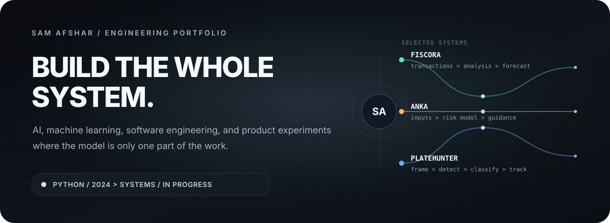
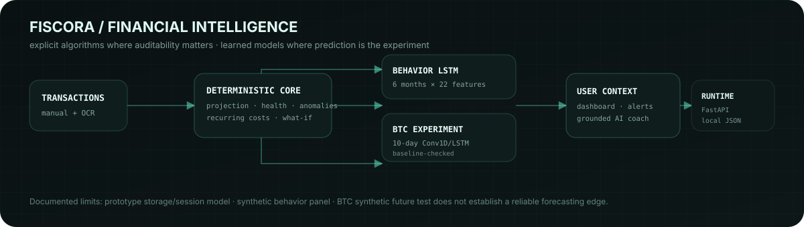
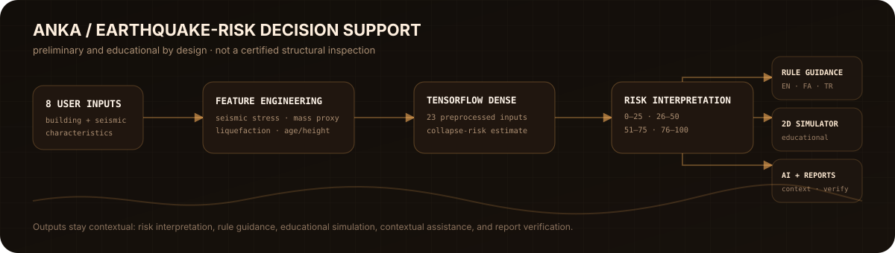
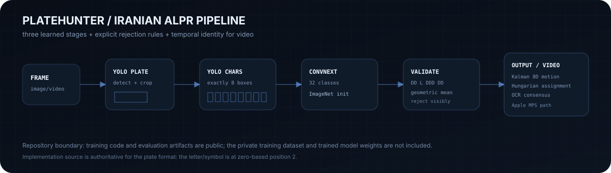

  

  <a href="https://github.com/SamAfshar2011/innoverse2026-Fiscora"><strong>Fiscora</strong></a>
  &nbsp;·&nbsp;
  <a href="https://github.com/SamAfshar2011/1i1w_competition"><strong>ANKA</strong></a>
  &nbsp;·&nbsp;
  <a href="https://github.com/SamAfshar2011/Persian_ALPR_project"><strong>PlateHunter</strong></a>

## I like the part after the model starts working.

I’m **Sam Afshar**. I started programming around **2024**, beginning with Python. Since then, the interesting part has shifted from “can I train a model?” to a harder question:

> **Can I turn the idea into a complete system that handles data, uncertainty, validation, failure states, interfaces, and real constraints?**

That is where I spend most of my time now: **artificial intelligence, machine learning, computer vision, software engineering, and product-oriented technical experiments**.

I’m still early in the journey. I would rather make that visible than cover it with inflated titles, fake skill percentages, or performance claims that the underlying work cannot support.

---

## 01 — Fiscora

**Fiscora** is a competition-oriented personal-finance intelligence application designed around a simple separation: use explicit algorithms where inspectability matters, and use learned models only where prediction is genuinely the experiment.

The repository currently includes:

- a deterministic month-end projection built from recent spending and weekday behavior, including bootstrap-based uncertainty;
- an explicit financial-health score, anomaly checks, recurring-payment detection, savings scenarios, and a What-If simulator;
- receipt OCR with review before transactions are committed;
- a multi-task **LSTM** that consumes a six-month sequence of scale-independent financial features to estimate next-month spending growth and overspend probability;
- an experimental **Conv1D/LSTM Bitcoin model** evaluated against simple baselines rather than presented as a trading oracle;
- a **FastAPI** backend, local JSON persistence, bilingual Iran/US behavior, notifications, and a context-aware AI assistant that retrieves computed financial facts instead of inventing account context.

The model-evaluation story is intentionally not polished into marketing. The behavior model’s recorded results come from a **synthetic-but-coherent training panel**, not a production population. The Bitcoin notebook’s documented future-dated synthetic test also **does not establish a material forecasting advantage over naive baselines**. I think keeping that visible makes the project stronger, not weaker.

**Engineering focus:** `Python` · `FastAPI` · `TensorFlow / Keras` · `LSTM` · `Conv1D` · `EasyOCR` · `pandas` · `NumPy` · `HTML / CSS / JavaScript`

**Source →** [github.com/SamAfshar2011/innoverse2026-Fiscora](https://github.com/SamAfshar2011/innoverse2026-Fiscora)

---

## 02 — ANKA

**ANKA** is an earthquake-safety competition project built as a **preliminary decision-support and educational system**, not a replacement for a structural engineer.

A user enters eight building and seismic parameters. The backend derives additional engineered features, aligns them with the training schema, scales the numerical inputs, and feeds a **TensorFlow dense network** that returns a collapse-risk estimate. The surrounding application then turns that estimate into understandable context rather than stopping at one number.

The current repository contains:

- four risk bands from low through critical;
- rule-based safety recommendations in **English, Persian, and Turkish**;
- a browser-based **2D earthquake simulator** with its own time-stepped physics loop and visual damage state;
- a contextual AI assistant that can receive the building state;
- generated PDF reports plus a report-registry / verification workflow;
- explicit disclaimers that predictions, recommendations, simulation, and reports are informational and preliminary.

The important boundary is part of the engineering: **ANKA is not a certified structural inspection, engineering report, or governmental safety evaluation.**

**Engineering focus:** `Python` · `TensorFlow / Keras` · `feature engineering` · `HTML / CSS / JavaScript` · `multilingual UI` · `PDF/report workflow` · `LLM-assisted guidance`

**Source →** [github.com/SamAfshar2011/1i1w_competition](https://github.com/SamAfshar2011/1i1w_competition)

---

## 03 — PlateHunter

**PlateHunter** is an Iranian automatic license-plate-recognition pipeline built as several explicit stages instead of one opaque “OCR model.”

The inference path is:

`frame → YOLO plate detector → plate crop → YOLO character detector → 8 sorted character crops → ConvNeXt classifier → format/confidence validation`

For valid Iranian plates, the implementation expects `DD L DDD DD`: seven digit positions plus one letter/symbol at zero-based position **2**. A result is not silently accepted just because each model returned something. The pipeline checks the exact character count, plate structure, stage-level confidence thresholds, and a final **geometric-mean confidence** so one weak stage is harder to hide.

Video adds another engineering layer: an **8D constant-velocity Kalman filter**, **Hungarian assignment**, appearance/geometry/OCR matching signals, and track-level OCR consensus to keep plate identities stable across frames. The inference configuration also includes an **Apple MPS** path for supported macOS hardware.

The repository publishes the training/inference code and evaluation artifacts, but it explicitly does **not** include the private training dataset or trained model weights.

### A real repository output

  
   
  Copied from the project’s own public inference assets; not a recreated mockup.

**Engineering focus:** `Python` · `PyTorch` · `Ultralytics YOLO` · `ConvNeXt Small` · `OpenCV` · `SciPy` · `Kalman filtering` · `Hungarian matching` · `Apple MPS`

**Source →** [github.com/SamAfshar2011/Persian_ALPR_project](https://github.com/SamAfshar2011/Persian_ALPR_project)

---

## The pattern I’m trying to build into my work

| Principle | What it means in practice |
|---|---|
| **Models are components, not products** | Training is only one layer. Data flow, validation, UI, fallbacks, storage, and outputs have to work around it. |
| **Use deterministic logic when it is the better tool** | A neural network is not automatically more intelligent than an explicit, testable rule or statistical calculation. |
| **Make uncertainty and rejection visible** | Bad inputs, missing dependencies, weak confidence, and unsupported conditions should fail clearly instead of producing confident-looking nonsense. |
| **Benchmark the exciting idea against the boring baseline** | If a complicated model cannot beat a simple baseline, that result belongs in the engineering story too. |

---

## Current technical orbit

I don’t use percentage bars for skills; they create precision without evidence. These are the technologies and problem areas that show up in the work above:

`Python` · `TensorFlow / Keras` · `PyTorch` · `YOLO` · `ConvNeXt` · `FastAPI` · `OpenCV` · `scikit-learn` · `SciPy` · `pandas` · `NumPy` · `OCR` · `HTML` · `CSS` · `JavaScript` · `REST APIs` · `multilingual interfaces` · `Apple MPS`

I’m especially interested in the boundary between **AI systems and products**: where model behavior meets software architecture, human-readable feedback, and decisions that have to remain understandable.

---

## A short trajectory

**2024** — Started learning programming with Python.

**Then** — Moved from individual scripts and models toward machine learning, computer vision, APIs, frontends, and complete application pipelines.

**Now** — Building larger systems, documenting their real limitations, and trying to raise both the engineering and product-quality bar with every project.

The long-term goal is larger than a portfolio: **build a technology startup around products that are genuinely useful, then learn how to turn it into a serious company.** I’m not there yet. That is the direction.

---

## Technology I pay attention to

I closely follow the work of **Apple, NVIDIA, Microsoft, Google, and Anthropic**, and I’m interested in the company-building and technology careers of **Steve Jobs, Bill Gates, and Sam Altman**.

This is not a logo wall or a claim of similarity. They are simply part of the technology landscape I study while forming my own taste in products, engineering, and ambitious companies.

---

## Find the source, not the sales pitch

Most of the interesting detail is in the repositories themselves: notebooks, validation logic, architecture decisions, limitations, and the parts that did not produce a perfect result.

  <a href="https://github.com/SamAfshar2011"><strong>Explore my GitHub → github.com/SamAfshar2011</strong></a>

  Sam Afshar · born December 2011 · learning by building

